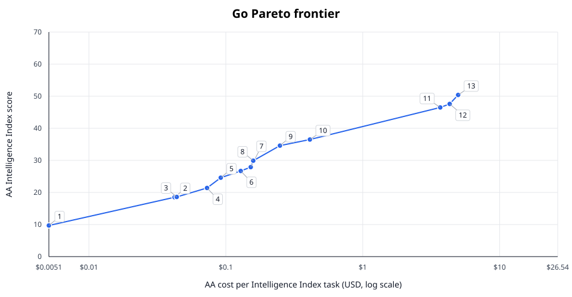
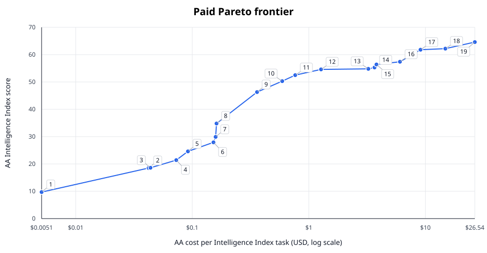

# OpenCode model frontiers

**AA Intelligence Index v5.0 · 2026-11-12 · 126 scored configurations**

Higher score, lower AA $/task is better. Each row is a non-dominated model/effort combination.
Point numbers match table rows. Both plots share numeric axes; task cost is logarithmic.
AA benchmark-task cost is a proxy—not your OpenCode bill or Go allowance usage. API version excludes patch numbers. [Methodology](README.md).

## Go frontier

**14/30 endpoints matched · 25 configurations · 12 frontier points**

### Curated picks

Score bands: Small <25, Medium <40, Strong ≥40 (lower bounds inclusive). Log-cost upper hull within each band; largest slope drop per band. Candidates less than 3 score points apart keep the cheaper one. Empty bands are omitted; endpoint fallback uses the highest score. These are selection heuristics, not measured score uncertainty.

| Tier | Plot # | AA configuration | Score | AA $/task |
|---|---:|---|---:|---:|
| Small | 5 | Claude Haiku 5.5 (Medium) | 24.6 | 0.0918 |
| Medium | 9 | Claude Haiku 5.5 (Xhigh) | 34.6 | 0.2484 |
| Strong | 12 | Gemini 4 Argon (High) | 50.4 | 9.9466 |

### Full frontier

| # | OpenCode model | AA configuration | Score | AA $/task |
|---:|---|---|---:|---:|
| 1 | `gpt-6-luna` | [GPT-6 Luna (Low)](https://artificialanalysis.ai/models/gpt-6-luna-low) | 9.7 | 0.0051 |
| 2 | `gpt-6-luna` | [GPT-6 Luna (Medium)](https://artificialanalysis.ai/models/gpt-6-luna-medium) | 18.5 | 0.0422 |
| 3 | `claude-haiku-5-5` | [Claude Haiku 5.5 (Low)](https://artificialanalysis.ai/models/claude-haiku-5-5-low) | 18.6 | 0.0438 |
| 4 | `gpt-6-luna` | [GPT-6 Luna (High)](https://artificialanalysis.ai/models/gpt-6-luna-high) | 21.4 | 0.0729 |
| 5 | `claude-haiku-5-5` | [Claude Haiku 5.5 (Medium)](https://artificialanalysis.ai/models/claude-haiku-5-5-medium) | 24.6 | 0.0918 |
| 6 | `mimo-v2.6-flash` | [MiMo-V2.6-Flash](https://artificialanalysis.ai/models/mimo-v2-6-flash) | 26.7 | 0.1285 |
| 7 | `gpt-6-luna` | [GPT-6 Luna (Max)](https://artificialanalysis.ai/models/gpt-6-luna) | 27.9 | 0.1520 |
| 8 | `claude-haiku-5-5` | [Claude Haiku 5.5 (High)](https://artificialanalysis.ai/models/claude-haiku-5-5-high) | 29.9 | 0.1586 |
| 9 | `claude-haiku-5-5` | [Claude Haiku 5.5 (Xhigh)](https://artificialanalysis.ai/models/claude-haiku-5-5-xhigh) | 34.6 | 0.2484 |
| 10 | `claude-haiku-5-5` | [Claude Haiku 5.5 (Max)](https://artificialanalysis.ai/models/claude-haiku-5-5) | 36.5 | 0.4110 |
| 11 | `kimi-k3.1-pro` | [Kimi K3.1 Pro](https://artificialanalysis.ai/models/kimi-k3-1-pro) | 46.5 | 3.6812 |
| 12 | `gemini-4-argon` | [Gemini 4 Argon (High)](https://artificialanalysis.ai/models/gemini-4-argon) | 50.4 | 9.9466 |

Not ranked: 4 missing score/cost; 3 unmatched identity/pricing; 1 unsupported effort.

## Paid frontier

**26/86 endpoints matched · 65 configurations · 19 frontier points**

### Curated picks

Score bands: Small <25, Medium <40, Strong <55, Flagship ≥55 (lower bounds inclusive). Log-cost upper hull within each band; largest slope drop per band. Candidates less than 3 score points apart keep the cheaper one. Empty bands are omitted; endpoint fallback uses the highest score. These are selection heuristics, not measured score uncertainty.

| Tier | Plot # | AA configuration | Score | AA $/task |
|---|---:|---|---:|---:|
| Small | 5 | Claude Haiku 5.5 (Medium) | 24.6 | 0.0918 |
| Medium | 8 | GPT-6.1 Sol (Low) | 34.8 | 0.1615 |
| Strong | 11 | GPT-6.1 Sol (Xhigh) | 52.5 | 0.7640 |
| Flagship | 15 | Claude Fable 5.2 (Medium, Default Fallback) | 56.4 | 3.8026 |

### Full frontier

| # | OpenCode model | AA configuration | Score | AA $/task |
|---:|---|---|---:|---:|
| 1 | `gpt-6-luna` | [GPT-6 Luna (Low)](https://artificialanalysis.ai/models/gpt-6-luna-low) | 9.7 | 0.0051 |
| 2 | `gpt-6-luna` | [GPT-6 Luna (Medium)](https://artificialanalysis.ai/models/gpt-6-luna-medium) | 18.5 | 0.0422 |
| 3 | `claude-haiku-5-5` | [Claude Haiku 5.5 (Low)](https://artificialanalysis.ai/models/claude-haiku-5-5-low) | 18.6 | 0.0438 |
| 4 | `gpt-6-luna` | [GPT-6 Luna (High)](https://artificialanalysis.ai/models/gpt-6-luna-high) | 21.4 | 0.0729 |
| 5 | `claude-haiku-5-5` | [Claude Haiku 5.5 (Medium)](https://artificialanalysis.ai/models/claude-haiku-5-5-medium) | 24.6 | 0.0918 |
| 6 | `gpt-6-luna` | [GPT-6 Luna (Max)](https://artificialanalysis.ai/models/gpt-6-luna) | 27.9 | 0.1520 |
| 7 | `claude-haiku-5-5` | [Claude Haiku 5.5 (High)](https://artificialanalysis.ai/models/claude-haiku-5-5-high) | 29.9 | 0.1586 |
| 8 | `gpt-6.1-sol` | [GPT-6.1 Sol (Low)](https://artificialanalysis.ai/models/gpt-6-1-sol-low) | 34.8 | 0.1615 |
| 9 | `gpt-6.1-sol` | [GPT-6.1 Sol (Medium)](https://artificialanalysis.ai/models/gpt-6-1-sol-medium) | 46.3 | 0.3594 |
| 10 | `gpt-6.1-sol` | [GPT-6.1 Sol (High)](https://artificialanalysis.ai/models/gpt-6-1-sol-high) | 50.3 | 0.5910 |
| 11 | `gpt-6.1-sol` | [GPT-6.1 Sol (Xhigh)](https://artificialanalysis.ai/models/gpt-6-1-sol-xhigh) | 52.5 | 0.7640 |
| 12 | `gpt-6.1-sol` | [GPT-6.1 Sol (Max)](https://artificialanalysis.ai/models/gpt-6-1-sol) | 54.6 | 1.2721 |
| 13 | `gpt-6-astra` | [GPT-6 Astra (High)](https://artificialanalysis.ai/models/gpt-6-astra-high) | 54.8 | 3.2386 |
| 14 | `gpt-6-astra` | [GPT-6 Astra (Xhigh)](https://artificialanalysis.ai/models/gpt-6-astra-xhigh) | 55.3 | 3.6589 |
| 15 | `claude-fable-5-2` | [Claude Fable 5.2 (Medium, Default Fallback)](https://artificialanalysis.ai/models/claude-fable-5-2-medium) | 56.4 | 3.8026 |
| 16 | `claude-opus-5-5` | [Claude Opus 5.5 (Xhigh, Default Fallback)](https://artificialanalysis.ai/models/claude-opus-5-5-xhigh) | 57.4 | 6.0472 |
| 17 | `claude-fable-5-2` | [Claude Fable 5.2 (High, Default Fallback)](https://artificialanalysis.ai/models/claude-fable-5-2-high) | 61.8 | 9.0784 |
| 18 | `claude-fable-5-2` | [Claude Fable 5.2 (Xhigh, Default Fallback)](https://artificialanalysis.ai/models/claude-fable-5-2-xhigh) | 62.2 | 14.8286 |
| 19 | `claude-fable-5-2` | [Claude Fable 5.2 (Max, Default Fallback)](https://artificialanalysis.ai/models/claude-fable-5-2) | 64.6 | 26.5386 |

Not ranked: 37 missing score/cost; 8 unmatched identity/pricing; 1 unsupported effort.

## Privacy filter

No request-data training; US/EU hosting only. Unknown endpoints excluded. Reviewed 2026-11-10.
- Go: `deepseek-v4-pro`, `deepseek-v4.1-flash`, `iceman-contributor-free`, `longcat-2.0`, `longcat-2.5-free`, `muse-spark-1.2-contributor`, `muse-spark-1.3-contributor`.
- Paid: `big-pickle`, `flint-40b-free`, `gemini-4-carbon`, `gemini-4-hydrogen`, `iceman-free`, `inkling-2-small-free`, `longcat-2.5-free`, `mimo-v2.6-flash-free`, `nemotron-3.5-lightning-free`, `nemotron-3.5-super-vl-free`.
Policy sources: [Go](https://opencode.ai/docs/console/go#privacy) · [Paid](https://opencode.ai/docs/console/models#privacy).

## Special pricing

OpenCode input/output $ per million tokens; does not alter AA $/task.

| Model | Available on | Catalog rates | Regular rates / condition |
|---|---|---:|---|
| `gemini-4-argon` | Go, Paid | $2/$10 | $4/$20 from 2026-12-01 |
| `gemini-3.6-flash` | Paid | $0.75/$3.75 | $1.5/$7.5 from 2027-01-01 |
| `gemini-3.7-flash` | Paid | $0.75/$3.75 | $1.5/$7.5 from 2027-01-01 |
| `gemini-3.8-flash` | Paid | $0.75/$3.75 | $1.5/$7.5 from 2027-01-01 |

Free endpoints excluded: 1 Go, 4 Paid.

Sources: [Artificial Analysis](https://artificialanalysis.ai/) · [Go catalog](https://opencode.ai/inference/go/v1/models) · [Paid catalog](https://opencode.ai/inference/v1/models), authenticated: workspace-enabled models only.
